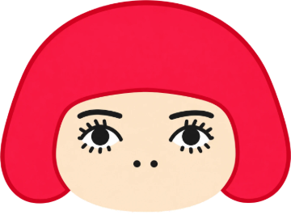

<p align="center">
  
</p>

<h1 align="center">hongido · 홍이도 스티커</h1>

<p align="center">
  사진만 고르면 스티커 용지의 정해진 칸에 꼭 맞게 인쇄되는 아이폰용 웹앱<br>
  <b>v1.0.6</b> · 2026.11.21 · Made by Seoulrain for Hongido
</p>

---

## 왜 만들었나
2026년 11월, 캐논 PIXMA TS8190 프린터로 사진 스티커를 즐겨 인쇄하는 아내 홍이도(필명)를 위해 만들었습니다.

- 이 프린터에 맞춰 쓰던 **캐논 정품 칼선 스티커 용지(PS-108)**를 구하기 어려워지면서, 대신 **에이원(A-one) 29602** 용지를 쓰기 시작했습니다.
- 그런데 용지에 딸린 인쇄 방법이 손에 맞지 않았습니다. 캔바로 칸 레이아웃을 직접 만들어 써 봤지만, 인쇄할 때마다 미세하게 틀어지는 위치를 맞추는 일이 생각보다 번거로웠습니다.
- 그래서 **사진만 고르면 칸에 정확히 들어가서 바로 인쇄되는 전용 앱**을 만들었습니다.

다꾸러(다이어리 꾸미는 사람)들은 스티커 인쇄 앱의 번거로움과 광고 때문에 불편을 겪곤 합니다.
이 앱은 광고가 없고, 사진을 서버로 보내지 않습니다.
**품질이 좋고 구하기 쉬운 스티커 용지를 알려 주시면 지원 용지 목록에 추가할 수 있습니다.** 아래 '용지 추가 요청'을 참고해 주세요.

- 앱 주소: https://hongido-stickers.pages.dev/
- 아이폰 사파리에서 열고 **공유 → 홈 화면에 추가**하면 앱처럼 쓸 수 있습니다.

## 할 수 있는 것
| | |
|---|---|
| **사진 넣기** | 빈 칸을 누르면 여러 장을 한 번에 고르고, 누른 칸부터 차례로 채워집니다. 가로 사진은 90° 돌려 들어갑니다. |
| **편집** | 사진 칸을 누르면 편집 화면. 한 손가락 이동, 두 손가락 확대·회전, 각도 눈금(−45°~+45°), 90° 돌리기, 좌우 반전. 칸에 흰 빈틈이 생기지 않게 자동으로 맞춥니다. PC에서는 마우스 휠과 확대 막대. |
| **필터** | 원본 · A6 · C1 · B1 · Dog1 · Pop. 작은 잉크젯 스티커에서도 차이가 보이도록 조정했고, 강도 조절과 '모든 칸에 적용'이 됩니다. |
| **자리 바꾸기** | 사진을 길게 눌러 다른 칸으로 끌면 옮기거나 서로 바꿉니다. 아래 휴지통으로 끌면 그 칸만 비웁니다. |
| **인쇄** | 실제 용지 크기 그대로의 PDF를 만들어 아이폰 공유 화면(프린트·캐논 앱)으로 보냅니다. 인쇄 직전에 용지 크기·배율·용지 방향을 한 번 확인시켜 줍니다. |
| **자동 저장** | 앱을 닫았다 열어도 작업이 그대로 돌아옵니다. |
| **오프라인** | 한 번 열어 두면 인터넷이 없어도 열립니다. |

## 지원하는 용지
| 용지 | 크기 | 칸 |
|---|---|---|
| **에이원(A-one) 29602** 스티커 | 엽서 100 × 148mm | 3×3 = 9칸 (칸 26×34mm, 칼선 24×32mm) |
| 4×6 광택 인화지 | 101.6 × 152.4mm | 1장 크게 |

용지는 `public/config.js`의 `PRESETS`에 추가하면 앱의 '용지 고르기' 목록에 나타납니다.
모든 길이는 mm 단위로 이 파일 한 곳에서만 관리합니다.

### 용지 추가 요청
GitHub **Issues**에 아래 내용을 남겨 주시면 검토해 추가합니다.
- 용지 제품명과 품번 (예: A-one 29602)
- 용지 크기, 칸 수와 배열, 칸(칼선) 크기와 간격 (mm)
- 가능하면 빈 용지를 자와 함께 찍은 사진

### 인쇄 위치를 맞춘 방법
1. 칸 테두리와 mm 눈금을 그린 시험지를 실제 스티커 용지에 인쇄했습니다.
2. 칼선과의 차이를 자로 재서 위 마진을 15mm → 18.7mm로 고쳤습니다.
3. 다시 인쇄해 9칸 모두 칼선이 오차 0.5mm 안에 들어오는 것을 확인했습니다.

프린터마다 조금 다를 수 있어서, 앱 설정의 **'인쇄 위치 맞추기'**에서 시험 인쇄와 보정(0.1mm 단위)을 할 수 있습니다.

## 사진과 개인정보
- 사진은 **기기 밖으로 나가지 않습니다.** 서버로 올리지 않고 브라우저 안에서만 처리합니다.
- 작업 저장도 아이폰 안의 저장 공간(IndexedDB)에만 합니다.

## 기술
- 빌드 도구 없이 **HTML · CSS · 바닐라 JavaScript**만 씁니다. 외부 라이브러리도 없습니다.
- **PDF는 직접 만듭니다**(`pdfwriter.js`). 필요한 건 선, 사각형, 영문 글자, JPEG 사진뿐이라 코드가 짧습니다.
- **사진 처리는 웹 워커**(`photo-worker.js`)에서 합니다. 화면과 따로 돌아서 처리 중에도 화면이 멈추지 않습니다.
- **필터는 33×33×33 색 보정표**로 계산합니다(`filters.js`). 큰 사진도 빠르게 처리됩니다.
- **오프라인은 서비스 워커**(`sw.js`)가 맡습니다.
- 배포는 **Cloudflare Pages**입니다. 이 저장소의 `main`에 올리면 자동으로 배포되고, 사이트로 내보내는 폴더는 `public/`입니다.

## 폴더 구조
```
SPEC.md          기획서와 결정 기록 (무엇을 왜 이렇게 만들었는지)
CLAUDE.md        작업 규칙
public/          앱 (이 폴더만 사이트에 올라감)
  index.html     첫 화면
  app.js         칸 배치 · 인쇄 · 자동 저장 · 끌어서 옮기기
  editor.js      사진 편집 화면
  photo.js       사진 불러오기 · 위치 계산
  photo-worker.js 사진 처리 작업자
  filters.js     필터 · 인쇄 보정
  pdfwriter.js   PDF 만들기
  config.js      용지 규격 · 버전 · 설정값
  store.js       자동 저장
  sw.js          오프라인
  test.html      인쇄 위치 맞추기 (시험 인쇄)
```

## 로컬에서 실행
```
python -m http.server 8000 --directory public
```
그다음 브라우저에서 http://localhost:8000 을 엽니다.
같은 와이파이의 아이폰에서는 `http://(PC의 IP 주소):8000`으로 열 수 있습니다.

## 버전
| 버전 | 날짜 | 내용 |
|---|---|---|
| v1.0.6 | 2026.11.21 | 아이콘을 다이컷 스티커 모양(홍이도 얼굴 + 흰 테두리)으로 꽉 채워 |
| v1.0.5 | 2026.11.21 | 앱 안 로고를 'hongid(얼굴) stickers'로, 아래 한글 줄 빼기 |
| v1.0.4 | 2026.11.21 | 홈 화면 아이콘·파비콘을 홍이도 얼굴로, 홈 화면 이름을 'hongido stickers'로 |
| v1.0.3 | 2026.11.21 | 만든 사람 표기를 Seoulrain(첫 글자 대문자)으로 |
| v1.0.2 | 2026.11.21 | 만든 사람 표기를 seoulrain으로 |
| v1.0.1 | 2026.11.21 | 넣는 방향 표시를 영문(FEED)으로, 만든 사람 표시를 영문으로 |
| v1.0.0 | 2026.11.21 | 첫 정식 버전. 9칸 스티커 인쇄, 편집, 필터, 자리 바꾸기, 자동 저장, 오프라인, 4×6 인화지 |

자세한 변경 이유는 `SPEC.md`의 '결정 기록'에 날짜별로 적혀 있습니다.

## 만든 사람
**Seoulrain**(서울비)가 **Hongido**(홍이도)를 위해 만들었습니다.
기획과 결정은 서울비가 하고, 코드는 [Claude Code](https://claude.com/claude-code)(Anthropic의 AI 코딩 도구)와 함께 작성했습니다.

에이원(A-one)은 해당 회사의 상표이며, 이 앱은 용지 규격에 맞춰 인쇄하기 위해 품번을 표기할 뿐 회사와 관계가 없습니다.
